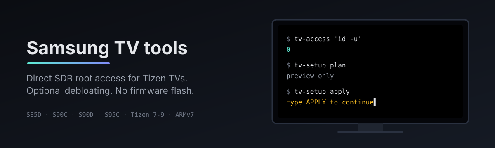

# Samsung TV tools



Linux tools for root commands, remote keys, screenshots and app cleanup on
Samsung Tizen TVs. Uses [chris-ritsen's archive-root bootstrap](https://github.com/chris-ritsen/samsung-tv-root).
No firmware flash.

Started on a QE77S90C. Owners of other 2023 and 2024 models have since reported
it working, up to Tizen 9. See the list below.

## Compatibility

Maintainer-tested means checked on our own TV. Community reports are not tested by us.
App cleanup (`tv-setup`) only runs on maintainer-tested builds, because app removal
is destructive and not fully reversible.

<!-- compatibility:start -->
| Model | Tizen | Firmware build | Works | Source |
|---|---|---|---|---|
| QE77S90C (S90C, 2023) | 7.0 | `T-PTMCDEUC-REL-202408210126` | root, keys, screenshot, cleanup | maintainer-tested |
| QE65S85D (S85D, 2024) | 9.0 | `T-PTMDDEUC-0090-REL-202609252355` | root, keys | [ibrahimvarola](https://github.com/invaliddayta/samsung-tv-tools/issues/3) |
| S90C | 9.0 | `T-PTMCDEUC-0090-REL-202603190158` | root, keys, screenshot | [ondererguven](https://github.com/invaliddayta/samsung-tv-tools/issues/4) |
| S90D | 8.0 | `T-PTMDDEUC-REL-202601212151` | root | [rkorn86](https://github.com/invaliddayta/samsung-tv-tools/issues/1) |
| S90D | 9.0 | `T-PTMDAKUC-0090-REL-202605141701` | root | [tpollard64](https://github.com/invaliddayta/samsung-tv-tools/issues/1#issuecomment-6391371635) |
| S95C | 9.0 | `T-PTMCDEUC-0090-REL-202603190158` | root | [magne4000](https://github.com/invaliddayta/samsung-tv-tools/issues/2) |
<!-- compatibility:end -->

**Tried it on your TV?** Run `tv-access --report`. It prints a short report
without IP addresses or serial numbers and a link to a prefilled issue.
Reports for builds already listed are welcome if you tested more features.
See [CONTRIBUTING.md](CONTRIBUTING.md).

## Root access

Use a trusted LAN. Turn off automatic firmware and app updates before starting.
**Do not update, downgrade or flash firmware to match a listed build.**
Read [the risks](SECURITY.md), then enable Developer Mode with your computer's
LAN IP ([instructions](docs/usage.md#developer-mode)).

```sh
git clone https://github.com/invaliddayta/samsung-tv-tools.git
cd samsung-tv-tools
export TV_HOST=192.0.2.10  # replace with your TV's address
nix run .#tv-access -- --probe
nix run .#tv-access -- 'id -u'  # must print 0
```

Without Nix, use `./tools/tv_access/tv-access` with Python 3, Bash and OpenSSL.
No Tizen Studio or developer certificate is needed.

Root access was tested across a normal reboot. Once SDB returns, each command
automatically gets root again. No custom boot service is installed.
SMACK/UEP and read-only filesystem restrictions still apply.

## Commands

| Command | Purpose |
|---|---|
| `tv-access 'command'` | Root command with stdout, stderr and exit status |
| `tv-access --probe` | Check root access and show whether your build is listed |
| `tv-access --report` | Shareable compatibility report |
| `tv-key XF86Home` | Remote-control key input |
| `tv-shot /tmp/tv.png` | Compositor screenshot, not protected video |
| `tv-setup plan/apply/verify` | Preview, apply or check selected settings and app removals |

Run commands with `nix run .#COMMAND -- ...`, or install the
[local symlinks](docs/usage.md#local-installation).

## Optional app cleanup

Only for the maintainer-tested S90C build. `tv-setup` refuses other builds.
The default profile selects 24 ad components and Ambient themes.
Streaming apps and device integrations are kept unless you select them.

```sh
mkdir -p local
cp profiles/s90c.json local/my-tv.json
# Read the consequences and edit remove: true/false.
nix run .#tv-setup -- plan --profile local/my-tv.json
nix run .#tv-setup -- apply --profile local/my-tv.json
nix run .#tv-setup -- verify --profile local/my-tv.json
```

Apply asks for confirmation. App removal can delete data and is not fully
reversible. Run it when nobody is watching. The individual guard controls were
tested on the TV, but the full automated apply workflow has only offline tests.
See [cleanup, guard and recovery](docs/debloat.md).

## Development

```sh
nix develop --no-write-lock-file
nix flake check --no-write-lock-file  # offline tests, no TV access
```

[Usage, builds and root mechanism](docs/usage.md) ·
[Contributing](CONTRIBUTING.md) ·
[Attribution and binary provenance](THIRD_PARTY.md)

First-party code: [MIT](LICENSE). Upstream bootstrap: Unlicense.
Not affiliated with Samsung.
